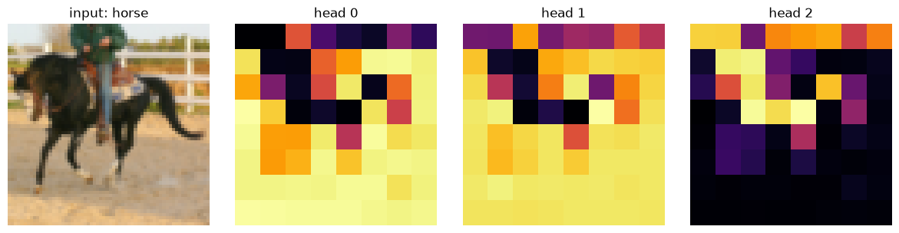
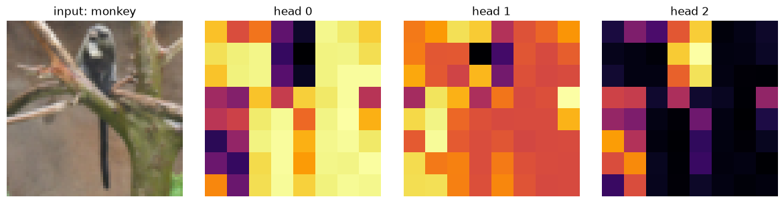
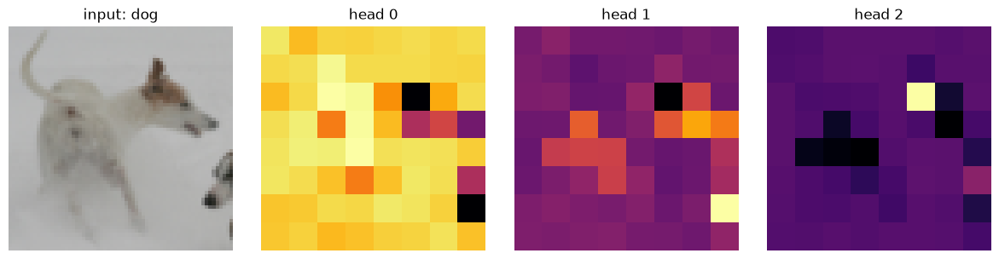
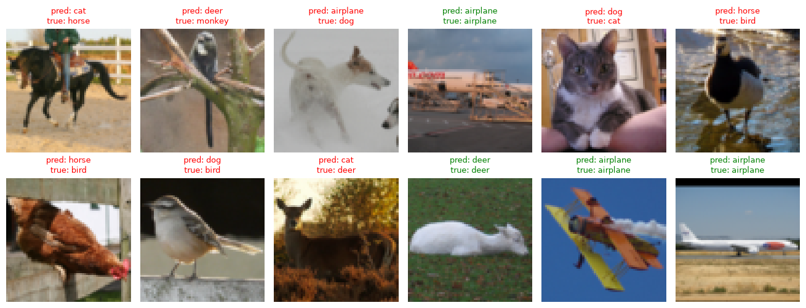
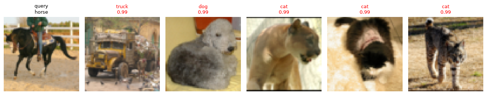
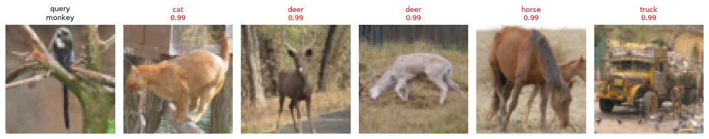

# DINO ViT-Tiny — Self-Supervised Vision Transformer from Scratch

A minimal, **CPU-friendly** re-implementation of [**DINO**](https://arxiv.org/abs/2104.14294)
(*self-**di**stillation with **no** labels*) built entirely from scratch in PyTorch — a
ViT-Tiny backbone, projection head, multi-crop augmentation, EMA teacher, and the
centering + sharpening loss. Trained on unlabeled [STL-10](https://cs.stanford.edu/~acoates/stl10/),
the model learns useful visual features **without a single label** and reproduces DINO's
signature result: **attention maps that segment objects on their own**.

> This is an educational implementation designed to run on a laptop CPU. Model and
> dataset sizes are scaled down from the paper (e.g. `out_dim = 4096` vs `65536`,
> `img_size = 64`, `5000` training images).

---

## Results

The trained **teacher backbone** is evaluated on the STL-10 **test** split three ways
(see [`test/test.ipynb`](test/test.ipynb)).

### 1. Attention maps — emergent segmentation

The CLS token's attention over the 8×8 patch grid, per head. No segmentation labels were
ever used — the object boundaries emerge purely from self-supervised training.





### 2. Linear-probe predictions

A single linear layer trained on **frozen** features (green = correct, red = wrong).
Linear-probe top-1 accuracy: **~36.5%** on 10 classes (chance = 10%).



### 3. Feature similarity / k-NN retrieval

Nearest neighbours by cosine similarity on the frozen features — good features cluster
same-class images together. 20-NN accuracy: **~32%**.




---

## Quick Run

**Requirements:** Python 3.9+.

```bash
git clone https://github.com/m0han-raj/DINO.git
cd DINO

python -m venv venv
source venv/bin/activate
pip install -r requirements.txt

python data/data_download.py

python -m src.train

python -m src.evaluate --ckpt outputs/checkpoints/dino_epoch20.pt

python -m src.visualize --ckpt outputs/checkpoints/dino_epoch20.pt

jupyter notebook test/test.ipynb
```

---

## How It Works

DINO trains **two networks with the same architecture** — a *student* and a *teacher* —
so that the student's output matches the teacher's across different augmented views of
the same image:

- **Multi-crop augmentation** — each image yields 2 global crops (64×64) and 4 local
  crops (32×32). The teacher sees only the global crops; the student sees all of them.
- **EMA teacher** — the teacher's weights are an exponential moving average of the
  student's (momentum `0.996 → 1.0` on a cosine schedule). It never receives gradients.
- **Centering + sharpening** — the teacher output is centered (running mean) and
  sharpened (low temperature) to prevent collapse, then used as a soft target via
  cross-entropy against the student.

## Repository Structure

```
DINO/
├── src/
│   ├── vision_transformer.py   # ViT-Tiny: patch embed, MHSA, blocks, attention extraction
│   ├── dino_head.py            # Projection MLP + weight-normalized prototype layer
│   ├── dino_loss.py            # Centering + sharpening cross-entropy loss
│   ├── augmentations.py        # Multi-crop augmentation (2 global + 4 local)
│   ├── train.py                # DINO training loop (student/teacher + EMA)
│   ├── evaluate.py             # Linear-probe evaluation on frozen features
│   └── visualize.py            # CLS-token attention map extraction
├── test/
│   ├── test.ipynb              # End-to-end evaluation notebook (source of images above)
│   ├── vit_sanity_test.py
│   ├── aug_sanity_test.py
│   └── head_loss_sanity_test.py
├── data/                       # STL-10 dataset + download script
├── outputs/                    # Checkpoints, attention maps (git-ignored)
├── assets/                     # README images
└── requirements.txt
```

## Model Configuration

| Component            | Value                          |
| -------------------- | ------------------------------ |
| Backbone             | ViT-Tiny (depth 6, 3 heads)    |
| Embedding dim        | 192                            |
| Image / patch size   | 64 / 8 (64 patches)            |
| Head output dim      | 4096 prototypes                |
| Crops                | 2 global (64²) + 4 local (32²) |
| EMA momentum         | 0.996 → 1.0 (cosine)           |
| Optimizer            | AdamW, lr 5e-4, wd 0.04        |
| Dataset              | STL-10 unlabeled (5000 images) |

---

## References

- **DINO paper** — Caron et al., *Emerging Properties in Self-Supervised Vision
  Transformers*, ICCV 2021. [arXiv:2104.14294](https://arxiv.org/abs/2104.14294)
- **Official DINO code** — [facebookresearch/dino](https://github.com/facebookresearch/dino)
- **ViT** — Dosovitskiy et al., *An Image Is Worth 16x16 Words*. [arXiv:2010.11929](https://arxiv.org/abs/2010.11929)
- **STL-10 dataset** — [cs.stanford.edu/~acoates/stl10](https://cs.stanford.edu/~acoates/stl10/)

---

## License

Released under the [MIT License](LICENSE).
